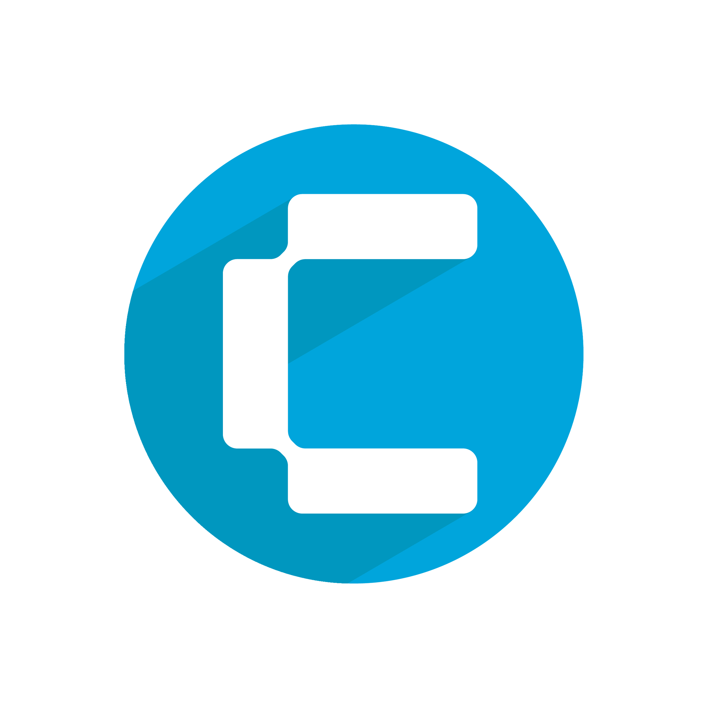
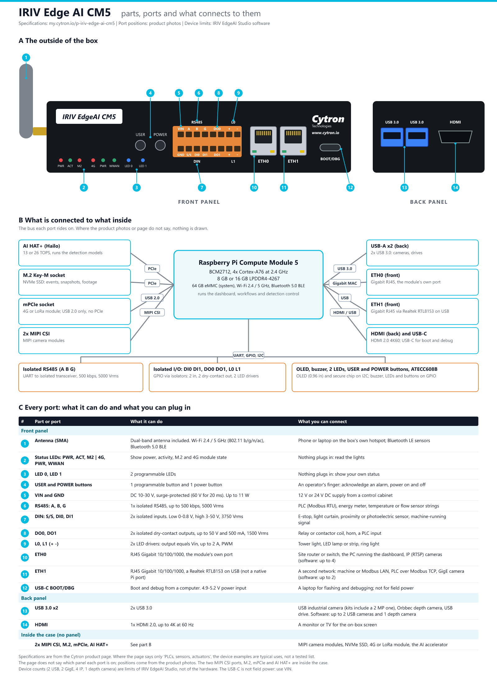
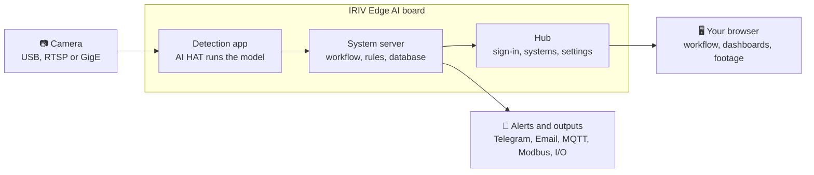

<div align="center">



# IRIV EdgeAI Studio

**Build your own AI camera systems on the IRIV Edge AI board, with no code.**
Your camera. Your AI. No code. IRIV EdgeAI Studio lets you build powerful vision systems with drag-and-drop workflows: detect, count, track, alert and visualise, all live in your browser.

[](VERSION)
[-0396b5)](#-what-you-need)
[](#-what-you-need)
[](https://www.cytron.io)

[Quick start](#-quick-start) •
[Features](#-features) •
[How it works](#-how-it-works) •
[Install](#-install-on-an-iriv-edge-ai-board) •
[Update](#-update-an-installed-board) •
[FAQ](#-faq)



</div>

---

## ⚡ Quick start

Already have an IRIV Edge AI board with an AI HAT on the network? Three commands:

```bash
ssh pi@<board-ip>
git clone --depth 1 https://github.com/adamafiq0108/IRIV-EdgeAI-Studio.git /tmp/iriv-src
cd /tmp/iriv-src && sudo bash scripts/install.sh
```

Then open **`http://<board-ip>`** in your browser. The first time, a short **setup** screen
appears: create your own **username** and **password** (and, optionally, a recovery email), then
sign in with them. There is no shared default account to type in.

> [!TIP]
> Not sure of the board's address? A new board is called `IRIV-EdgeAI-Studio`, so try
> **`http://IRIV-EdgeAI-Studio.local`** (a second board on the same network is
> `IRIV-EdgeAI-Studio-2.local`, and so on - the front-panel screen shows the name), or look the
> board up in your router's list of devices.

---

## ✨ Features

<table>
<tr>
<td width="50%" valign="top">

### 🧩 Visual workflow editor
Drag nodes onto a canvas and wire them up: a **Detection Stream**, **Class** and **Zone
Filters**, **Counters**, **If / Else**, **Triggers** and more. Wires show which way the data
flows, and a red **✕** marks a wire with a problem.

### 🔁 Reusable functions and groups
Wrap a set of nodes in a **Function** frame and call it from anywhere. Tag related nodes with a
coloured **Group**. Anything you have built can be dragged out again from **On this canvas**.

### 📊 Live dashboards and analytics
Turn any number into a **Card Widget** or **Chart Widget**, lay out your Dashboard and Analytics
pages with a drag-and-drop builder, and pick the dates you want to look back over.

</td>
<td width="50%" valign="top">

### 🚨 Alerts and actions
Raise violations, paint boxes and zones on the live video, take an **Image Snapshot** or a
**Recording Clip**, and send a **Telegram message** or an **Email** when something happens.

### 🗄️ Database built in
Log events into tables you design, query them, export CSV, and trigger on totals with a
**Recorded Trigger** ("more than 50 violations today").

### 🔌 Talks to your plant
**MQTT**, **Modbus** (read and write), **REST webhooks**, and the board's own **digital I/O**,
**buzzer** and **PWM**, all as nodes in the same workflow.

</td>
</tr>
</table>

**Guided all the way:** every page has a step-by-step guide, the Workflow guide teaches a full
system in three short modules, and the **Nodes Guideline** explains every node and its settings.

---

## 🧠 How it works



- **One board, several systems.** Each system (for example *parking* or *safety-zone*) has its
  own cameras, workflow and dashboards, and its own server process.
- **The hub** is the front door on port `5100` (and port `80`): sign-in, the Systems page,
  network and account settings.
- **The detection app** runs the AI model on the AI HAT and hands every detection to the
  system's workflow.

---

## 📋 What you need

| | Requirement |
|---|---|
| **Board** | An **IRIV Edge AI** device: Raspberry Pi **Compute Module 5** based, or fitted with the IRIV secure element |
| **AI accelerator** | An **AI HAT** with a Hailo-8, Hailo-8L or Hailo-10H |
| **OS** | Raspberry Pi OS (64-bit) |
| **Storage** | An **NVMe drive** is strongly recommended for recordings |
| **Camera** | USB (UVC), RTSP/IP, or GigE Vision |
| **Network** | Internet during installation |

> [!IMPORTANT]
> The software runs **only on IRIV Edge AI devices with an AI HAT**. If not, it shows an error
> (*RUN ONLY IN IRIV EDGE AI DEVICES* / *AI HAT REQUIRED*).

---

## 🚀 Install on an IRIV Edge AI board

<details open>
<summary><b>1. Connect to the board</b></summary>

From your computer:

```bash
ssh pi@<board-ip>
```

Everything below runs **on the board**.
</details>

<details open>
<summary><b>2. Download the software</b></summary>

```bash
git clone --depth 1 --branch main \
  https://github.com/adamafiq0108/IRIV-EdgeAI-Studio.git /tmp/iriv-src
```
</details>

<details open>
<summary><b>3. Run the installer</b></summary>

```bash
cd /tmp/iriv-src && sudo bash scripts/install.sh
```

It checks the hardware, installs everything, and starts the services. Expect **10-20 minutes**
on a fresh board. It is safe to run again later: your settings, recordings and models are kept.

At the end it prints where to open the dashboard. The first visit there asks you to create your
own account.
</details>

<details>
<summary><b>Installer options</b> (click to expand)</summary>

| Option | What it does |
|---|---|
| `--db-host <host>` | Use a shared database server instead of one on the board |
| `--no-database` | Run without a database (tables can be designed, no rows stored) |
| `--hub-port <n>` | The hub's port (default `5100`; can be changed later in Settings) |
| `--no-mqtt` | Skip the built-in MQTT broker |
| `--keep-vnc` | Leave the VNC remote desktop running (off by default) |
| `--no-service` | Build and copy only; write no services and start nothing |
| `-h`, `--help` | Every option, with details |
</details>

<details open>
<summary><b>4. Check it worked</b></summary>

```bash
systemctl is-active irivai-hub                              # active
curl -s -o /dev/null -w '%{http_code}\n' localhost:5100     # 200
```

Then open **`http://<board-ip>`**: the first time it shows the setup screen where you create
your username and password; after that it shows the normal sign-in.
</details>

<details>
<summary><b>5. Recommended: secure SSH</b> (click to expand)</summary>

The installer already hardens the board. To go further, change the `pi` password and allow
SSH keys only:

```bash
sudo passwd pi
echo 'PasswordAuthentication no' | sudo tee /etc/ssh/sshd_config.d/99-no-passwords.conf
sudo systemctl restart ssh
```

> [!WARNING]
> Add an SSH key you can log in with **before** turning off password login, or you will be
> locked out of the board.
</details>

---

## ⬆️ Update an installed board

The latest update is always on the
[**`updates`** branch](https://github.com/adamafiq0108/IRIV-EdgeAI-Studio/tree/updates) as one
`irivai-<version>.tar.gz` file.

1. Download the `.tar.gz` from the
   [`updates` branch](https://github.com/adamafiq0108/IRIV-EdgeAI-Studio/tree/updates).
2. On the dashboard (admin account), open the account menu and choose **About**.
3. In **Software update**, press **Choose update file**, then **Install**.

Settings, recordings, models and systems are kept, and the previous version stays available
(**Go back to …**) if you need it.

<details>
<summary><b>For maintainers: publishing an update</b></summary>

Bump [`VERSION`](VERSION) (a board refuses the version it already runs), commit, then:

```bash
bash scripts/publish_update.sh
```

It builds the dashboard and the update file and replaces the `updates` branch with it.
</details>

---

## 🖱️ First steps after installing

1. **AI Models**: put a model in use and switch on the classes you need (for example *person*).
2. **Camera Setup**: choose your camera and draw a zone.
3. **Workflow**: open the guide (top right) and build the first module, *Basic AI System*.
4. **Dashboard**: press **Edit dashboard**, drop your cards on, then press **Start**.

Each page opens with its own guide the first time, and the **Guide** button brings it back.

---

## 🔌 Turning the software off and on

<details>
<summary><b>Show the commands</b></summary>

**Off.** It stays off after a reboot. Nothing is uninstalled and no data is lost.

```bash
sudo systemctl disable --now irivai-hub irivai-mediamtx
sudo systemctl stop 'irivai-master@*'                     # system servers run as services
sudo pkill -u cytron -f 'master_server.py|-m app.run'    # systems the hub had started
```

**On again:**

```bash
sudo systemctl enable --now irivai-hub irivai-mediamtx
```

Systems come back up when they are opened from the Systems page (or by themselves, if they are
set to start automatically).

**Shut down or reboot the board** from the dashboard's account menu. The software is switched off
cleanly first, so the board powers off quickly.
</details>

---

## ❓ FAQ

<details>
<summary><b>Login says "RUN ONLY IN IRIV EDGE AI DEVICES" or "AI HAT REQUIRED"</b></summary>

The software found no Compute Module 5 and no IRIV secure element, or no AI HAT. Check the AI
HAT is seated, then restart the board.
</details>

<details>
<summary><b>I can't find the board's address</b></summary>

The board's front-panel screen shows its name and address. A new board is called
`IRIV-EdgeAI-Studio`, so `http://IRIV-EdgeAI-Studio.local` works from most computers on the same
network. On its own hotspot the board is at `http://192.168.1.1`. Your router's list of connected
devices shows it too.
</details>

<details>
<summary><b>Recordings are filling the disk</b></summary>

Fit an NVMe drive. Without one, footage is stored on the system disk.
</details>

<details>
<summary><b>Where are the logs?</b></summary>

On the dashboard under **Administration → Logs** (admin account). Every request has an ID, and
an error carries the same ID, so one search finds it.
</details>

---

## 📚 Documentation

| Doc | Covers |
|---|---|
| [`docs/setup.md`](docs/setup.md) | Installation, pairing, verification, troubleshooting |
| [`docs/install-appliance.md`](docs/install-appliance.md) | Installing onto an IRIV Edge AI device |
| [`docs/configuration.md`](docs/configuration.md) | The `.env` file, hotspot address, hostname, where settings live |
| [`docs/software-update.md`](docs/software-update.md) | Updating the software |
| [`docs/features.md`](docs/features.md) | What the product does, feature by feature |
| [`docs/architecture.md`](docs/architecture.md) | How it is built |
| [`docs/api.md`](docs/api.md) | REST API reference |
| [`docs/database-schema.md`](docs/database-schema.md) | Database schema |
| [`docs/contract-v1.md`](docs/contract-v1.md) | How an AI system plugs into the dashboard |
| [`docs/conventions.md`](docs/conventions.md) | Code structure and rules for contributors |

All of them are indexed in [`docs/README.md`](docs/README.md).

## 🤝 Contributing

Issues and pull requests are welcome. Read [`CONTRIBUTING.md`](CONTRIBUTING.md) first, and
report security problems privately as described in [`SECURITY.md`](SECURITY.md).

## 📄 License

See [`LICENSE`](LICENSE). Open-source components keep their own licences.

<div align="center">
<br>
Made with ❤️ by <a href="https://www.cytron.io"><b>Cytron Technologies</b></a>
</div>
