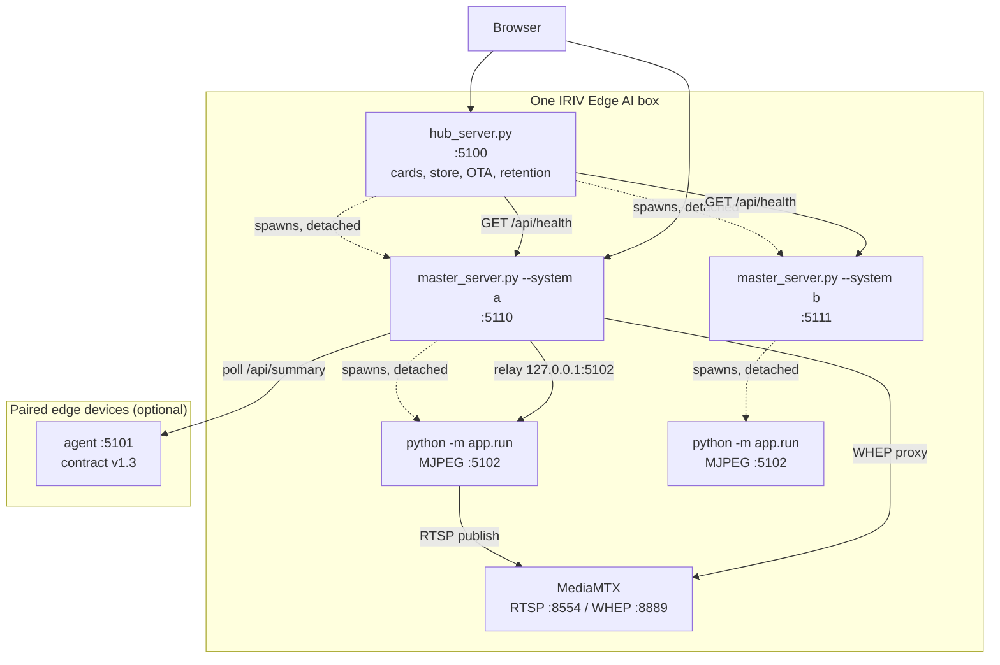
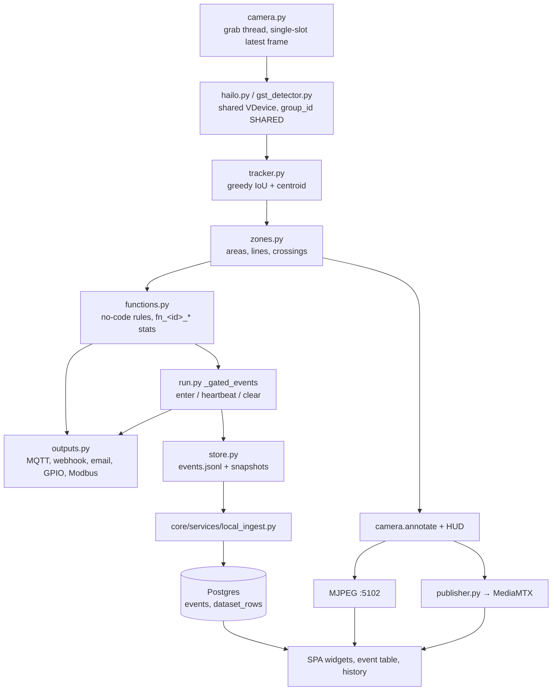

# Architecture

Living document - updated as the product changes.

How IRIV Edge AI is put together, and why it is put together that way. This is the Design-phase
companion to `docs/contract-v1.md`, which specifies the wire protocol between a master and a
device, and to `docs/database-schema.md`, which covers what gets persisted. This document covers
the processes, the ports, the flow of a frame from lens to dashboard, and the layouts on disk.

The product runs on a Raspberry Pi CM5 with a Hailo-8 accelerator, and every decision below is
shaped by two facts about that box. It has one AI chip and a small number of camera readers, so
sharing them correctly is not an optimisation but the difference between working and not working.
And it is an appliance in a factory with no shell, no git and often no one on site - so anything
that can fail must fail into a state an operator can read off a screen and recover from.

---

## 1. The three-tier process model

Three kinds of process, and each boundary exists because something goes wrong without it.



### 1.1 The hub - `hub_server.py`, port 5100

One process, in front of the masters, and it does exactly one thing: draw a card per system and
link to that system's master.

**It deliberately does not proxy.** A hub that proxied would have to understand every master's
pages, hold their sessions and stream their video - at which point it is a second master with none
of the data, and every system's outage becomes the hub's outage (`hub_server.py:8-12`). Cards link
out; the master serves its own pages. That is why a master going down greys its own card and
touches nothing else.

What the hub does own, because it is box-wide rather than system-wide: creating and deleting
systems (`core/routes/hub.py`), the online template store (`/api/hub/store`), platform OTA updates
(`/api/hub/update`), the account and audit surfaces, the capacity meters, and the retention sweep
(`hub_server.py:186-197`).

Boot does a specific sequence of repairs before anything else reads state
(`hub_server.py:75-117`), and each step is there because of a real failure:

1. `migrate_generated_to_store()` - move any hub-created system still sitting in the repo's
   `systems/` dir into the persistent store, so a `git pull` cannot lose it.
2. `repair_store_apps()` - refresh every created system's app **code** from the built-in
   reference, because a created system carries a copy from its creation day and would otherwise
   run stale code missing every later fix.
3. `enforce_python_policy()` - sweep out Python-node code written while `[python].enabled` was on.
   A kill switch has to kill something; without this, code written before the flag was turned off
   kept running until someone happened to re-save that workflow.
4. `heal_master_hosts()` - a board that changed address has master URLs naming a host that is no
   longer it, and the hub would then refuse to start its own systems. Repoint them at loopback.
5. `reconcile_masters()` - give every discovered system a master URL if its config entry was lost,
   so a recovered system shows a working card instead of "no master configured".

Then autostart, unless an update is mid-flight (§6).

### 1.2 One master per system - `master_server.py`, ports 5110 and up

Two systems is two of these, each with its own port, its own device registry and its own pages.
The file is deliberately thin and names no system and no customer: the slug comes from `--system`,
the package from the systems directory, the pages from `core/`. Adding a system is a new folder
plus a config line, and the diff to `master_server.py` is zero - if you are editing that file to
add a system, something is wrong (`master_server.py:9-12`).

Ports are allocated by `next_master_url()` (`core/services/provision.py:967-978`): the highest port
already in use plus one, starting from 5110, and then **probed by actually binding**. The config is
not the whole truth - a stale master from a deleted system may still hold a port the config has
freed, and handing that port to a new system makes its card answer as the dead one.

A master runs five background loops as asyncio tasks (`master_server.py:385-404`), and they are
separate because their cadences are unrelated:

| Loop | Cadence | Does |
|---|---|---|
| `_sync_loop` | `[sync].interval_s`, default 600 s | discovery sweep, then `/api/summary` for every paired device |
| `_health_loop` | `[sync].health_interval_s`, default 15 s | two tiny GETs per device, so a device going down flips within seconds instead of up to ten minutes |
| `_local_loop` | 5 s | drain the local detection app's `events.jsonl`, sample the history rings |
| `_email_loop` | 30 s tick | fire each configured digest time once per day |
| `_blynk_loop` | configured | push mapped stat values to Blynk |

`LOCAL_INGEST_INTERVAL_S = 5` is its own constant for a reason (`master_server.py:265-274`).
Draining a local log used to ride the slave sync loop, whose shipped interval is 600 s. With a
2000-row cap per pass that is a hard ceiling of about 3.3 rows a second - and a system writing
faster than that did not slow down, it *lost* rows: `events.jsonl` grew until it rotated and the
reader found its cursor had been rotated past. Draining a log on the same disk has nothing to do
with how often remote devices are polled.

The two loops share `app.state.events`, so both take the same `ingest_lock`
(`master_server.py:390`). They are different asyncio tasks and a list both rewrite is a race
however unlikely the overlap looks.

### 1.3 One detection app per running system - `python -m app.run`

The AI. Its own process, spawned detached with cwd set to the system package
(`systems/demo/app/runtime.py:245-250`). At most `MAX_RUNNING_APPS` (4) run at once, which is what
sets `MAX_SYSTEMS = 4` (`core/services/provision.py:36-44`): a system that exists but can never
start is a card that only ever disappoints.

**The app imports nothing from `core/`.** Not a style rule - it is what lets the app run standalone
on a bare Pi with no dashboard installed, and it is why a handful of constants are duplicated on
purpose (`MAIN_CAMERA`, `MIN_CAMERA_FPS`, the WebRTC path naming rule, the board pinout, and the
expression validator's whitelist). Each duplication carries a comment naming its twin.

The app also never knows a master exists. It writes; the adapter reads. A master outage cannot
stop detection, and that separation is what lets the dashboard report "detection stopped" rather
than the whole device vanishing (`docs/contract-v1.md` §1).

**Liveness is a fact on disk, not a variable in memory.** `state.json` holds
`{pid, started_at, running, camera, detector, error, heartbeat}` and is rewritten every loop cycle
(`systems/demo/app/runtime.py:5-11`). But `running` is decided by the **process**, not the
heartbeat (`runtime.py:101-142`): loading a HEF takes tens of seconds and reopening a dropped RTSP
camera can block longer, both *inside* the loop, and during either one every page confidently
reported the app stopped while its stream was still up. So a live, owned pid is running, and a
stale heartbeat is reported separately as `stalled`.

The obvious objection to trusting a pid is reuse - the recorded number could belong to a text
editor by now. `_owns()` answers it by reading `/proc/<pid>/cmdline` for `app.run` and comparing
`/proc/<pid>/cwd` against the package (`runtime.py:145-174`), and returns True where there is no
`/proc` at all, because refusing to report a running app on a dev laptop is worse than the reuse it
defends against.

`/proc` is also the ground truth the pid file is not. A doomed twin that died on its stream-port
bind used to overwrite the pid and take the record down with it, leaving the real app running,
streaming, holding the camera and the Hailo, and invisible - so "starting again" bred another
doomed twin. `start()` now scans `/proc` and **adopts the survivor** instead of racing it
(`runtime.py:230-234`), and `stop()` kills strays the pid file has lost track of
(`runtime.py:270-276`).

### 1.4 Who spawns whom, and the cgroup fact

Both spawns go through `subprocess.Popen` with `start_new_session=True` on POSIX and
`DETACHED_PROCESS | CREATE_NEW_PROCESS_GROUP` on Windows - masters at
`core/services/provision.py:1626-1635`, apps at `systems/demo/app/runtime.py:246-250`.

Detaching gives them their own session and controlling terminal. **It does not move them out of the
parent's systemd cgroup.** Restarting `irivai-hub.service` therefore takes every master it spawned
with it, no matter how they were detached (`scripts/apply_update.py:383-386`). That is normally
what you want - one restart, whole stack - and it is exactly why the OTA applier must run as its
own systemd unit (§6.2).

Two consequences follow from spawning-and-not-waiting:

- Nobody calls `.wait()` on a spawned master, by design: spawning must not block the hub's request
  thread. On POSIX that leaves a zombie the moment the child exits, one per master restart,
  accumulating for the life of the box (found live: four, one per restarted master, sitting since
  their bounce). A background thread doing nothing but `.wait()` reaps it without making the caller
  block (`core/services/provision.py:1636-1646`).
- `start()` sleeps 0.8 s and checks `proc.poll()` before recording a pid, so a child that dies
  instantly on a taken port or an import error never overwrites the pid of whatever is actually
  running (`runtime.py:251-259`).

A real deployment does not rely on hub-spawning at all: `scripts/install.sh` writes
`irivai-hub.service` and a templated `irivai-master@.service` per system, with the port coming
from `/etc/irivai/<slug>.env` (`scripts/install.sh:407-440`). Ports are never arguments to the
install script - they come from `config/systems.toml`, because the hub probes and links each master
at the URL configured there, and a master started on a disagreeing port is invisible to the hub
while the process is up and healthy.

### 1.5 Why masters run copied app code per system

A created system does not symlink or import the reference detection app. It gets a **copy** of it,
written by `_scaffold_app()` at creation time (`core/services/provision.py:1036-1049`).

The copy exists because a system's app is its own thing: it may carry `store_ext/` extension code
from a signed template bundle, and its `config.toml` / `config.local.toml` are edited constantly by
the dashboard. Sharing one tree between systems would mean one system's template code and one
system's zones landing in another's pipeline.

But a copy freezes. A `git pull` updates the reference and not the copies, so created systems drift
into running the code of their creation day - which presented as "everything except demo is
broken". `repair_store_apps()` closes that at every hub and master boot by re-copying `app/`,
`scripts/` and `models.toml` from the reference into every store system
(`core/services/provision.py:1279-1333`). What it must never touch is listed explicitly:
`config.toml`, `config.local.toml`, `data/`, `models/`, `system.py`, `layout.json`
(`:1273-1276`). And `app/store_ext/` is stashed and restored around the refresh, because the
reference has no copy of it and a plain `rmtree` + `copytree` would silently delete a paid
template's code on every hub boot (`:1310-1327`).

The corollary matters operationally: **a running system executes its own copy of the app under the
store**. Pulling to the repo checkout is not enough on its own - the copies are refreshed at boot,
so the masters have to be restarted for it to take.

### 1.6 Ports

| Port | Process | Notes |
|---|---|---|
| 5100 | hub | overridable with `--port`; recorded into `$CYTRON_HUB_PORT` so the OTA health gate polls the right one (`hub_server.py:275-277`) |
| 5101 | agent | fixed by contract v1 (`docs/contract-v1.md` §1) |
| 5102 | detection app MJPEG | `[app].stream_port`; **bound to 127.0.0.1** by default because the feed is unauthenticated (`systems/demo/app/run.py:754`). One port serves every camera of the system, addressed by `?camera=<id>` |
| 5110+ | masters | one per system, allocated by highest-in-use + 1 with a bind probe |
| 8443 | hub, HTTPS | only while HTTPS is switched on (Settings -> Network -> HTTPS); a second listener in the hub process, same app (`core/tlsserve.py`). Configurable; 8443 is in `hubport.RESERVED` so no system or hub port takes it |
| 443 | nft redirect -> the HTTPS port | only while HTTPS listens and the `web-redirect.py` root helper has the `tls_on` action (table `inet irivai_web_tls`); without it HTTPS answers on 8443 only |
| 80 | nft redirect -> the hub's port | reverse-proxy mode only (`core/services/webaccess.py`, table `inet irivai_web`) |
| 5173 | Vite dev server | development only |
| 8554 / 8889 / 9997 | MediaMTX RTSP / WHEP / control API | loopback only (`core/services/streaming.py:37-41`) |

### 1.7 The SPA, served by both hub and masters

There is one React bundle, not two. `frontend/vite.config.js` builds to `../core/static/app`
(`:36-40`) - an `index.html` plus a content-hashed `assets/` directory - and both server processes
mount it identically: `/assets` as static files, and a catch-all returning `index.html` for every
client route so URLs stay clean and hashed assets cache hard (`hub_server.py:244-257`,
`master_server.py:579-592`). The catch-all is registered **last**, so every real route and mount
wins, and an unknown `/api/` path still 404s as JSON rather than being handed the SPA shell.

The same bundle behaves as the hub or as a master depending on the `mode` its `/api/bootstrap` call
returns.

There are, however, two **builds** (`frontend/vite.config.js:16-26`). `__DEV_TOOLS__` is
substituted as a literal at build time, so `__DEV_TOOLS__ ? lazy(() => import(...)) : null`
collapses to `null` in `npm run build:customer` and Rollup never emits the chunk. The developer
panels are *absent* from the shipped bundle, not hidden behind a check a curious user can flip in
devtools - matching the backend, where `scripts/install.sh` does not copy `core/dev/` and the
routes those panels call therefore do not exist (`core/deploy.py`, `config/deploy.toml`).

A system package may also ship `templates/<page>.html` and a `static/` directory, which override
core's by filename for that system's own master only (`master_server.py:468`, `:509-512`). What
never moves is `_base.html`, `_nav.html` and `core.css` - every system's pages extend the same
shell, so switching between systems never feels like switching products.

---

## 2. Data flow: lens to dashboard



The modules are all in `systems/demo/app/`, which is the reference package every created system
copies.

**Capture - `camera.py`.** One reader per physical camera, and the loop owns it; everything else
reads what the module last produced. `Camera.open()` (`:365`) resolves the source - a numeric USB
index pinned to V4L2, an RTSP or HTTP URL over FFmpeg, a `gige:` Aravis pipeline, a `gst:` pipeline,
or a file - and starts `_grab_loop` on a daemon thread (`:620`). That thread calls `cap.grab()` flat
out and pays for `retrieve()` plus downscale only at `self.fps`, which keeps the frame fresh
without paying to decode frames nobody will look at. The handoff to the loop is a **single-slot
latest-frame buffer** under a lock (`:731-744`): old frames are overwritten, never queued. That is
the backpressure policy for the whole pipeline - drop, never accumulate.

**Inference - `detector.py` / `hailo.py` / `gst_detector.py`.** `detector.build()` picks from a
registry of `mock`, `none`, `yolo`, `hailo` and `onnx`. Every detector returns the same shape:
`{"label", "confidence", "box": [x1,y1,x2,y2]}` in frame pixels. The Hailo path uses a **shared,
round-robin-scheduled VDevice** with `group_id = "SHARED"` (`hailo.py:251-254`) - the HailoRT
scheduler time-slices it across every model and every process, and a second VDevice raises
"VDevice released while CIM in use". This is also why one detector is built and shared across all
of a system's cameras (`run.py:1091-1093`).

`[detector].kind = "gstreamer"` selects a completely different path: `gst_detector.py` builds a
`tee` into a display branch plus one `hailonet`+`hailofilter` inference branch per model, so NMS
decoding happens on-chip and in-pipeline. That detector owns capture *and* inference, so `camera.py`
is bypassed for it and it is single-camera by construction.

Inference has a failure ladder rather than a crash: ten consecutive failures demote to a fallback
detector - never mock on a real system - and schedule a jittered retry
(`run.py:1478-1489`).

**Tracking - `tracker.py`.** Dependency-free greedy matching: IoU on normalised boxes with a
same-label bonus, then a centroid fallback, then new tracks bounded at `MAX_TRACKS = 256`. Expiry
counts frames rather than wall clock, so a slow loop does not silently drop identities. It
**mutates the detection dicts in place**, adding `track_id` and `age_s`, and returns the live track
map. Retuning on a config reload uses `retune()` rather than a rebuild (`tracker.py:151-157`), so
live ids - and every timer keyed on them - survive an edit.

**Zones - `zones.py`.** Points are normalised 0..1. An `area` needs three or more; a `line` needs
exactly two. `ZoneEngine.update()` returns counts per zone, crossings per line with direction and
class breakdown, and the violating detections, and again annotates the detection dicts in place
with `zones`, `zone_in` dwell seconds, and `violation`/`zone`. A line crossing counts only on a
genuine sign flip - sitting on the line does not latch. `stats()` flattens the result to scalars:
`objects_in_frame`, `violations_now`, `zone_<id>_count`, `line_<id>_{in,out,occupancy}`.

**Functions - `functions.py`.** The no-code analytics layer: 21 types covering dwell, unique
counts, line travel time, proximity, guards, countdowns, occupancy, arithmetic expressions over
other stats, and inputs polled from HTTP, MQTT, Modbus or a board pin. **Functions are data, never
code.** An `expr` is parsed by `compile_expr()` against a strict AST whitelist and `eval()` is
never called; the master-side validator in `core/services/functions.py` mirrors the same whitelist,
and the app re-validates on load - so a bypassed API still cannot plant executable code
(`core/services/functions.py:12-17`).

Nothing that can block runs on the loop. `api_poll`, `mqtt_sub` and `modbus_read` each run their
own background thread and the loop reads whatever it last left behind. Output types are the same:
webhook, email and Telegram sends go to threads, and a `delay_s` becomes a `threading.Timer` with a
snapshotted stats dict rather than a sleep (`outputs.py:124-136`).

**Events - `run.py`.** Events are emitted on **transitions**, not per frame. `_AlarmGate`
(`run.py:123`) edge-triggers: an `enter` event, then a bounded `heartbeat` every
`event_heartbeat_s` so downstream liveness never mistakes "still there" for silence, then one
`clear` carrying the incident's duration after `event_clear_hold_s` of continuous absence - the
hold being what stops one missed detection frame from splitting an incident in two. Per-frame
emission wrote about 480,000 identical rows a day for a single parked object
(`systems/demo/config.toml:19-27`).

**Outputs - `outputs.py`.** Two entry points, both driven from the loop. `fire()` matches an event
against each output's trigger and optional `function` binding. `publish()` runs every frame and each
publisher self-paces - that is where clock-driven MQTT telemetry, PWM following and zone switching
live. Kinds: `dataset`, `gpio`, `io_out`, `io_pwm`, `mqtt`, `modbus`, `webhook`, `email`,
`telegram`, `snapshot`, `record`.

**Storage - `store.py`.** Append-only JSONL plus a snapshot directory, and the storage choice is
what makes the contract's cursor rule satisfiable at all. The cursor is
`generation * GEN_STRIDE + byte offset` - monotonic, never reused, and restart-proof because it is
a property of the files rather than a counter in memory (`systems/demo/app/store.py:9-21`). See
`docs/database-schema.md` §3.3 for the rotation and archive rules.

**Ingest - `core/services/local_ingest.py`.** The master tails that same log into its in-memory
ring and into Postgres as `host_serial = "__local__"`, with no pairing and no agent
(`master_server.py:233-262`). A paired remote device takes the other route: `sync.poll_all()`
against its agent's `/api/summary`, cursor-resumed, with the same `events_repo.expand()` widening
on the way in.

**Drawing.** `_draw()` annotates once and three consumers read the same frame - the MJPEG stream,
the WebRTC publish, and snapshots/clips (`run.py:1620-1636`). One annotate call, three consumers,
so they can never disagree about what the operator saw.

### 2.1 Frame handoff and sharing, in brief

Three facts a design reader should carry away.

**The loop paces at the slowest camera**, and sleeps *net* of work already done - sleeping the full
interval on top of inference halved the real rate (`run.py:1948`, `:2114-2120`).

**Per-camera state is isolated; the detector is shared.** Each camera gets its own tracker, zone
engine, function engine, capture and gates (`run.py:544-566`), because sharing them cross-matches
objects between cameras. The detector cannot be per-camera, for the VDevice reason above. The price
is that cross-camera stats are one frame stale - each camera's functions see last frame's
system-wide merge - which is called out in the code as the honest cost of having no cross-camera
ordering (`run.py:1529-1536`).

**Chip sharing is a table, not a division.** Up to four cameras get no FPS cap at all; beyond that
a `MIN_CAMERA_FPS = 10.0` floor applies (`run.py:290-318`), rebalanced every five seconds.

---

## 3. Config layering

`core/config.py` implements one rule everywhere: a committed `<name>.toml` holds structure and safe
defaults, a gitignored `<name>.local.toml` holds secrets and per-device values, and local wins
**per key** with sub-tables merged field-by-field (`core/config.py:5-12`). Overriding one password
does not wipe its siblings.

Only the local half is ever machine-written, through `save_local()`, which writes a sibling temp
file, chmods it `0600`, and `os.replace`s it in (`core/config.py:497-520`). Comments do not survive
a rewrite, which is precisely why machine-managed entries belong in the local file and nowhere
else. A caller adding one key must start from `load_local()` rather than `load()`, because
`save_local()` rewrites wholesale - handing it a merged dict would copy today's defaults into the
override and freeze them for a deployment that should follow them (`core/config.py:343-354`).

A malformed TOML file raises rather than falling back to defaults (`core/config.py:325-328`): a
typo would otherwise boot a deployment with the wrong brand or the wrong database, silently.

`docs/database-schema.md` §3.1 tables every file and what owns it. The short version: `brand`,
`systems`, `slaves`, `storage`, `auth`, `monitoring`, `builtin`, `deploy`, `workflow`, `store` and
`update` are the platform surfaces; each system package carries its own `config.toml` +
`config.local.toml` pair, which the dashboard never reads - the app and its adapter do.

That per-system local file is the hot-reload channel. `core/services/detector_control.py` writes it
one key at a time, and the running app re-reads its `[[cameras]]`, `[[zones]]`, `[[functions]]`,
`[[outputs]]`, `[capture]` and `[hud]` tables within two seconds without a restart. The whole
no-code product is built on that one mechanism.

---

## 4. The store root

`core/config.py store_dir()` (`:118-189`). Persistent root for **user-generated content** - systems
the operator creates, their layouts, workflows, templates, history, images - and deliberately
outside the repo checkout so a `git pull` or a redeploy never overwrites or loses it.

Resolution order, and the rule that matters most is the second one:

1. `$CYTRON_STORE` - the operator said so; taken at its word.
2. **Existence beats preference.** A candidate that already *contains* a store wins over an empty
   one, whatever the preference order says. "First writable wins" once re-homed a box's entire
   store to a freshly-writable empty `/mnt/nvme/cytron/store` - a `chown` had made it writable
   mid-life - and every system, layout and workflow on the box silently vanished from the
   dashboard. A store never relocates as a side effect of a directory becoming writable.
3. Both populated: not silently merged or picked. The preferred one is used so the box still boots,
   and a loud once-per-process report names both roots and tells the operator to consolidate
   deliberately. Merging two populated stores by guesswork is how content gets overwritten.
4. Nothing anywhere: first writable candidate in preference order - the NVMe when usable.

The chosen root is stamped with a `.cytron_store` marker so it keeps winning after its content is
legitimately emptied, and recorded in `.store_location` so a move between runs is a detected,
printed event rather than something the operator discovers as empty screens.

### 4.1 NVMe layout

The eMMC wears out under the event store's write traffic and a busy snapshot directory; the NVMe is
the right home for both (`scripts/setup_nvme.sh:1-16`).

```
/mnt/nvme/
  cytron/
    store/                       the store root (systems, layouts, workflows, history, update, …)
    <slug>/data/                 per-system events.jsonl, snapshots/, clips/, state.json
    <slug>/archive/              rotated per-day gzip event archives
  model/                         the ONE shared models dir
  postgresql/<ver>/<cluster>/    the moved Postgres data directory
```

The Postgres move is done with the cluster stopped and **keeps the original copy** as a backup, so
a bad move is recoverable by hand.

### 4.2 Models

Two questions, deliberately answered by two different functions
(`core/config.py:248-305`).

`shared_models_dir()` answers *"where should a new download go"* - one directory: `/mnt/nvme/model`
when the drive is really mounted, an existing `systems/demo/models` next, otherwise a directory in
the store. One shared directory means a HEF is fetched once and reused by every system, never
re-downloaded per system.

`model_search_roots()` answers *"where might a model already be"*, and returns every root any
release has ever written or read: today's write target, `/mnt/nvme/model` even when not chosen, the
historical `systems/demo/models`, the pre-NVMe store fallback, `$CYTRON_MODEL_DIR`, and the legacy
`/home/pi/model`. **The write target is not the search path.** Deriving `installed()` from the
single write target made an upgraded box with an empty `/mnt/nvme/model` report every
already-fetched model as "not downloaded". Existence on disk, not preference, decides whether a
model is installed.

The app resolves a HEF the same way and, on total failure, raises naming every path it tried
(`systems/demo/app/hailo.py:109-156`).

---

## 5. Video

Two transports, kept because they fail differently
(`core/services/streaming.py:1-29`).

**MJPEG (default).** The detection app JPEG-encodes each annotated frame and serves a multipart
stream on `127.0.0.1:<stream_port>`. Two relays sit in front of it, and the distinction is
important:

- `/api/detector/preview` (`core/routes/models.py:898`) relays the **local** app's stream. The app
  and the master share the box, so there is no pairing and no token - this is the standalone board
  watching itself. It uses `http.client` rather than `urlopen` so the *connect* fails fast (a dead
  app is a 502 in five seconds) while a *read* pause is not an error: the app pauses for seconds
  while it reopens a dropped camera or hot-reloads a model, and a 5-second read timeout cut the
  stream mid-watch every time.
- `/video_feed/{host_serial}` (`core/routes/proxy.py:72`) relays a **paired device's** stream. The
  browser never sees the device's bearer token - the master attaches it server-side. Routes take a
  `host_serial` and not a URL, because proxying a caller-supplied URL would make the master an open
  relay. These paths do not start with `/api/`, which is what the session wall keys its 401 on, so
  they are named explicitly in `PROTECTED_PREFIXES` *and* every handler re-checks the session
  itself - two independent checks, because this router is the one that pays for a mistake in the
  other one.

The app's own stream server caps viewers at 12 and **evicts the oldest** to admit a new one,
preferring to drop `/video_feed` watchers over `/raw` consumers; only past twice the cap does it
answer 503 (`systems/demo/app/run.py:759`, `:876-891`).

**WebRTC.** The app's GStreamer pipeline encodes H.264 once and publishes to MediaMTX over loopback
RTSP; the browser plays it in a `<video>` element. Cheaper per viewer and far lower latency, but it
needs the gateway running, a working UDP path and a codec the browser accepts.

One MediaMTX path per camera, `"<slug>__<camera_id>"` - flat because MediaMTX paths are flat,
double-underscore because a single one is legal inside both halves and would make them ambiguous
(`core/services/streaming.py:21-23`). The naming rule is duplicated in the app, which imports
nothing from `core/`.

The gateway's signalling port is loopback-only. The browser reaches it through the master's
authenticated `/api/detector/webrtc/...` WHEP proxy, so watching a camera requires a session
exactly as the MJPEG relay does. Only the media port is exposed, and media is DTLS-SRTP with ICE
credentials that come from the authenticated answer.

Crucially, `mode()` (`core/services/streaming.py:112`) is where the config *asks* and the code
*answers with what can actually be served*: a system set to WebRTC on a box whose gateway is down
is told "mjpeg", so its pages show a picture rather than an explanation. A broken WebRTC path
degrades to a working picture, never to no picture.

**View passthrough (opt-in, `[video] feed = "passthrough"`).** For an RTSP camera the live view
skips the app entirely: camera main stream -> MediaMTX (relay only) -> browser WebRTC. The app
registers one on-demand pull per camera through the gateway's loopback control API
(`systems/demo/app/passthrough.py`), under the same `"<slug>__<camera_id>"` name the legacy publish
uses, and starts no publisher for that camera. Detection keeps decoding its own (sub-)stream. It
requires `[video] overlay = "client"` (the camera's picture has no boxes burned in) and a main-stream
address: `view_source` on the camera entry (same host as the detect source), or derived from the
detect URL (Hikvision `/Streaming/Channels/x02`, TP-Link `stream2`, Dahua `subtype=1`, and their
main-stream forms). Anything else stays legacy and reports why in the camera's state. The master's
`stream_ready` counts a configured pull as servable before its first viewer, and holds a camera on
MJPEG for two minutes after a failed cold start. Costs and limits: two RTSP sessions per camera while
somebody watches (some cameras refuse a second one: the page falls back to MJPEG), and none while
nobody does. The camera address, credentials included, lives only in the app's and the gateway's
memory; any local process can read it back from the gateway's config API (loopback only).

### 5.1 The camera share registry

One raw V4L2 camera has one reader, but several systems may want the same camera. The app that
opens the device registers `{source -> {port, pid, camera}}` in a JSON file in the system temp
directory (`systems/demo/app/camera.py:36-46`); another app that finds the device busy asks
`shared_feed_source()` and consumes the owner's unannotated `/raw` MJPEG over loopback instead.
One grab and one decode of the physical camera, however many systems watch it.

The registry is runtime state and pid-checked, so a crashed owner's entry is simply ignored. Writes
go through an **exclusive flock** (`camera.py:57-102`): the unlocked read-modify-write lost changes
when two apps saved in the same moment, and it was watched live - an owner's entry appearing and
vanishing within seconds as other apps' heartbeats clobbered it, and the system waiting on that
entry stuck on "Camera connecting" for ever. Readers stay lock-free, because the write itself is an
atomic `os.replace`.

A numeric source with no exact owner falls back to any other live numeric owner
(`camera.py:138-169`), because a USB camera's index wanders between `/dev/video` nodes when it
re-enumerates and treating the miss as "nobody owns it" made both systems fight over the hardware.
The alias is suppressed when udev slot symlinks (`/dev/cam-usb<n>`) are installed, since then a
numeric source is canonical and the alias would quietly serve one socket's system the other
socket's picture.

The dashboard drinks from the same tap: `_shared_feed_jpeg()`
(`core/services/detector_control.py:645`) reads the registry to take a preview frame while an owner
holds the device, because opening it there would simply fail.

Separately, `core/services/cameras.py` answers a different question at the fleet level: which
camera *IP* is already assigned to which paired device, so the Manage page can warn before the same
physical camera is assigned twice. It only ever feeds a warning - the route lets the operator
override, because sharing one camera across devices while testing is legitimate.

---

## 6. Auth, sessions and SSO

One credential store serves the hub and every master on a machine
(`core/services/auth.py:1-18`).

- The administrator account is `admin` by default - a default, not the identity - with a salted
  hash in the gitignored `auth.local.toml`. It used to be written in clear next to the session
  signing secret, so anyone who could read one file had both the admin credential *and* the ability
  to mint sessions, on a file every master process reads at startup. The cleartext key is removed
  on write, and a legacy cleartext value is rewritten as a hash on the first correct login
  (`core/services/auth.py:160-197`).
- Operator accounts live in `users.local.toml`, each with a per-user salt and hash, an `enabled`
  flag, a `developer` flag, and the list of system slugs it may open (`"*"` = all).

**The SSO mechanism is a shared secret plus a host-scoped cookie.** A session is
`"user|expiry|hmac"` signed with `[session].secret` from `auth.local.toml`, generated once so a
restart does not log everyone out. Cookies are scoped by host and ignore the port - so one login at
`http://board:5100` is already valid at `http://board:5110`, and every master on the box verifies
it with the same secret it reads from the same file. No token exchange, no redirect dance, and no
central session service to be down.

Access model: the hub admits any valid account; a master admits an account whose systems list
contains its own slug (`master_server.py:545`, `hub_server.py:215`). The admin passes everything.

Sessions are also a *registry*, in `sessions.local.toml` - one table per session id with user,
coarse device word, IP, login/expiry/last-seen and a revoked flag. That is what makes a session a
thing that can be listed and revoked rather than only a signature that has to be waited out. The
token stays self-proving (signature first, registry second), so verification never needs a
database.

Two caches matter for performance and correctness. `verify_session` runs on every request of every
user, and two blocking disk reads inside the auth middleware is what made ten concurrent users feel
each other - so the two local files are cached and re-read only when their mtime changes
(`core/services/auth.py:41-67`). But mtime cannot be trusted for *our own* writes: ext4 stamps
whole milliseconds, so two writes in one tick share an mtime and the second is invisible, which
made a revoked session read back as not-revoked on the Pi. `_save_local()` therefore drops this
process's cache explicitly; another process's write is still picked up by mtime, where human-scale
timing makes a shared tick irrelevant.

Device authentication is a separate axis entirely, specified in `docs/contract-v1.md` - bearer
tokens per paired device, `hmac.compare_digest` comparison, pairing accepted only when unpaired or
inside an operator-opened unlock window, and zero-downtime rotation via keep-both-valid.

**Over HTTPS the cookie has its own name.** A sign-in over TLS (the hub's HTTPS listener, or a
master reached through the hub's relay, which says `X-Forwarded-Proto: https`) sets
`__Secure-cytron_session` with `Secure`; over HTTP it is `cytron_session` as before
(`core/routes/authtls.py` `_cookie_name`, `_session_cookie`). One Secure cookie under the plain name
would block every later plain-HTTP sign-in on the same host - a browser never lets `http://` replace
a Secure cookie - and HTTP stays open beside HTTPS. Over TLS only the `__Secure-` cookie is read
(no fallback: a plain cookie planted by a forged `http://` response would be session fixation), a
sign-out over TLS ends both cookies of the same account, and a write over TLS must come from an
`https` page. The consequence to know: in PORT mode the
systems are on their own plain-HTTP ports, so a sign-in made on the HTTPS hub is not sent to them
and a system opened from there asks for a sign-in once. In reverse-proxy mode every system is under
the hub's HTTPS address and one sign-in covers all.

### 6.1 HTTPS with the box's own root certificate

Owner decision, 2026-10-10: a per-box local CA, off until an admin switches it on (Settings ->
Network -> HTTPS, master or developer). Not Let's Encrypt or a real domain (that is a deployment's
reverse proxy, `core/services/remote.py`), not a tunnel.

- **Certificates** (`core/services/tlscert.py`): an EC P-256 root, 10 years, `CA:TRUE` pathlen 0,
  keyCertSign + cRLSign, ExtendedKeyUsage serverAuth (web servers only: no code, mail or client
  certificates in a client that applies a CA's EKU), and a critical **NameConstraints** extension:
  it may vouch only for `.local`, `localhost`, `home.arpa`, `.lan`, `.internal` and private,
  link-local, CGNAT (100.64/10) and loopback addresses; e-mail names only at `invalid` (so none),
  URIs only on those names. Never the bare hostname: a permitted DNS name is a whole subtree, so a
  box named `ai` would have had a root for every `.ai` site. A client that
  trusts it therefore trusts nothing on the internet from it, even if the box's key leaks - but it
  does trust it for every local name and private address on the LAN, other devices included. The
  server certificate (fresh EC key every issue, at most 397 days, never past the root, serverAuth)
  names `<host>.local`, avahi's name, `localhost`, `127.0.0.1`, `::1` and every stable
  interface address the root allows (`core/services/tlsnames.py`, no fork; IPv6 temporary and
  link-local addresses left out). A public address is left out and reported on the card.
- **Storage** (`core/services/https.py`): one file, `config/https.local.toml` - settings, root,
  certificate and both keys - created 0600 with `mkstemp`, fsynced, swapped in atomically, never
  logged, gitignored, and carried into each new release by `apply_update.carry_config` like every
  `*.local.toml` (a root lost at an update would make every client re-trust the box). Nothing is
  generated until HTTPS is switched on. A crash between write and unlink can leave a 0600
  `config/.https-load-*.pem` (leaf key) or `config/.https.*.tmp` (root key): both are gitignored
  (`config/.https*`) and the hub's start deletes them (`httpsrun.sweep`: those names, regular
  files only, older than a minute).
- **Re-issue** (`https.ensure`): within 30 days of expiry, signed by another root, damaged, or the box
  has a name/address the certificate lacks. Asked at enable, at hub start, and from the TLS
  handshake itself at most every 30 s (`core/services/httpsrun.py live_context`), so a DHCP move,
  a Wi-Fi switch or a new hostname is covered on the very next connection with no polling loop. A
  name that merely went away does not re-issue. A damaged or expired ROOT fails closed with a
  sentence; only the admin's confirmed "New root" replaces it.
- **Serving** (`core/tlsserve.py`): TLS ends at the hub, the box's one front door. A second
  `uvicorn.Server` in the hub process, same app and event loop, started in the background from the
  HTTP server's lifespan (HTTP never waits for it), with no signal handlers of its own and a socket
  it binds itself (a taken port is a sentence on the card, not uvicorn's `sys.exit`). Its
  `ssl.SSLContext`: TLS 1.2 minimum, ECDHE + AEAD suites, no compression or renegotiation; an SNI
  callback hands each new connection the current certificate, so a new one needs no restart. Masters
  stay plain HTTP on their ports; through the relay they see `X-Forwarded-Proto: https`.
- **Port 443** is an nft redirect to the HTTPS port made by the existing `web-redirect.py` root
  helper (`tls_on` / `tls_off`, own table and state file, same sudoers rule as port 80).
- **"Send browsers to HTTPS"** (off by default): a 307 for GET/HEAD page loads over plain HTTP from
  another machine (`Accept: text/html` or `Sec-Fetch-Mode: navigate`); never `/api/`, a system's API
  through the relay, assets, the box's own kiosk (loopback), a forwarded request, or HTTPS itself.
  No HSTS: it would lock HTTP users out for its whole max-age.
- **Fails closed, HTTP untouched**: a damaged file reads as OFF with the reason; a certificate that
  cannot be loaded or a taken port leaves the listener down, says why on the card and in the admins'
  Inbox at start, and the hub carries on over HTTP.

---

## 7. Zones and workflow compilation

The Workflow page lets an operator wire the pipeline as nodes:

```
Detection Stream -> Class Filter -> Zone -> Analytics -> Dashboard / Output
```

**The graph is an authoring format, never an execution format.** On save it is compiled into the
artifacts the platform already runs (`core/services/workflow.py:11-33`):

| Node kind | Compiles to | Runs in |
|---|---|---|
| analytics | `[[functions]]` documents in the system's `config.local.toml` | the app's `functions.py` engine, unchanged |
| output | `[[outputs]]` documents, each bound to its function by the `function` field | `app/outputs.py fire()` |
| dashboard | Builder widgets on a dedicated "Workflow" layout page | the SPA |

The graph itself persists as JSON at `<store>/workflows/<slug>.json` - same doctrine as Builder
layouts: user-generated, outside the repo, atomic temp-then-replace.

Compiling to existing artifacts rather than to a runtime is what keeps the detection app
standalone and keeps documents as data. Three conventions hold the compilation together:

- **`fnId` is minted once at node creation and never regenerated on rename.** Stat keys are
  `fn_<id>_*`, and history series and widget bindings are keyed on them - regenerating an id on
  rename would orphan every chart the operator had built.
- **Compiled outputs and widgets carry a `wf_` prefix.** Anything without it is hand-made and is
  preserved on merge, so the editor never eats an operator's manual work.
- **Compile errors do not block saving the graph.** Auto-save must never lose canvas work; errors
  block only the artifact writes and surface as node badges.

An unconnected node is a draft, and a draft must not count, alert or write history - so a function
type that consumes detections stays switched off until a Detection Stream reaches it. Only the
types that consume no detections (`expr`, `api_poll`, `mqtt_sub`, `total`, `board_input`,
`modbus_read`) run standalone (`core/services/workflow.py:52-59`).

Python Function nodes are gated twice over. `config/workflow.toml [python].enabled` is off by
default and deliberately not switchable from the web UI - turning it on means an account can
execute arbitrary Python on the box, so it must cost shell access. Editing the code additionally
requires the developer tier. The app side refuses to import a `wf_code/` file that is not listed in
`.wf_manifest.json` with a matching sha256, and a handler that throws once is benched for the run
with `fn_<id>_error = 1` published in its place
(`systems/demo/app/extensions.py:104-132`, `:161-197`).

Template code shipped inside a **signed** store bundle is a different path - `app/store_ext/`, which
is refused unless the installer's `.manifest_sha256` marker is present - and is unaffected by that
flag.

---

## 8. The template store and OTA updates

Both distribute signed content from GitHub to an appliance with no shell. They use **different
signing keys**, on purpose.

### 8.1 The template store

Templates are full system exports published to two GitHub repos: a free public one and a pro
private one (`config/store.toml`). Every template folder carries a manifest signed with the owner's
ed25519 key, whose public half ships in the product, and the manifest records a sha256 for every
other file including the HEFs - so **one signature covers the whole bundle**. A box refuses
anything that does not verify, which makes the GitHub repos a dumb transport rather than a trust
root (`core/services/store.py:12-19`).

Paid access is a license key the owner issues at payment time, `IRIV1.<payload>.<signature>`. The
payload holds the device serial, the tier, an **absolute** expiry - the countdown starts at
purchase, so re-entering an old key cannot restart it - and the customer's read-only GitHub token
encrypted against that serial. Activation requires internet: expiry is checked against server time
taken from GitHub's `Date` header, and the box keeps a high-water mark of the latest server time it
has seen, so winding the clock back cannot revive a dead key. The honest limit is stated in the
code: a paying customer can extract their own token from their own key - inherent to serverless
licensing - but the token is read-only and scoped to the store repo alone, so the blast radius is
the paid catalogue and never the product source.

Install order is chosen so everything that can fail cheaply fails first
(`core/services/store.py:595-760`): check the catalogue entry and the tier, detect the box's Hailo
arch and confirm the template has a build for it, check the system cap, download and verify the
bundle and the per-arch HEF - and only then create the system, through the same import path a
hand-uploaded export uses. Extension code is written to `app/store_ext/` **only from a bundle that
just verified**, together with the `.manifest_sha256` marker the app requires before it will import
any of it.

The signing private key (`config/store_signing.pem`) exists only on the owner's hub. It is
gitignored, and `scripts/install.sh` deletes it if it is ever found on an appliance
(`scripts/install.sh:381-385`) - its presence is what unlocks license issuing, so it has no
business on a customer box even by accident.

### 8.2 OTA platform updates: blue/green

A release is not a set of files copied over the old ones. It is a **directory of its own** under
`/opt/irivai-releases`, with its own virtualenv, built completely before anything live changes.

```
/opt/irivai-releases/v2.1.0/     this version, complete, with its venv
/opt/irivai-releases/v2.0.4/     the previous one, still complete
/opt/irivai-systor -> …/v2.1.0   what every systemd unit and every config path uses
```

Going live is one atomic rename of the symlink; rolling back is the same rename the other way.
There is no window in which the running tree is half one version and half another - power loss
before the rename leaves the old release untouched, power loss after it leaves the new one complete
(`scripts/apply_update.py:22-31`, `scripts/install.sh:234-248`). `flip()` uses
`os.symlink` to a temp name then `os.replace`, which on a symlink is a single rename.

Nothing in the product knows a release directory exists: the units, the venv path and every config
path stay `/opt/irivai-systor`.

**The hub must not be the process applying the update.** The hub spawns its masters as children and
they share its cgroup, so an updater started by the hub would be killed the instant it restarted
`irivai-hub` - mid-swap, with nothing left alive to finish or to roll back. So `apply()` does not
fork a worker: it asks systemd to start `irivai-apply.service`, which lives in its own cgroup
(`core/services/update.py:14-25`). That is the one `sudo` call this feature makes, and the reason
for the narrow sudoers rule the installer writes (`scripts/install.sh:500`), which permits exactly
three `systemctl` verbs and nothing else.

The applier runs from a **copy of itself** on the store volume, because the tree is what is being
replaced, and it imports nothing from `core/` - stdlib only - because the interpreter it runs under
must not depend on either release. Copying the *running* version's script also means each release
ships the applier that installs the next one, so an improvement to the update process reaches a box
the same way every other change does (`core/services/update.py:441-460`).

The phase order in `do_apply()` (`scripts/apply_update.py:638-758`) is the safety argument:
everything that can fail cheaply happens before the first byte of live state changes.

1. **Preflight** - refuse a downgrade; refuse a box whose store fell back *inside* the code tree,
   because updating it would delete its systems and recordings and it needs its storage fixed, not
   an update; verify the manifest signature; check free space for the tarball, the unpacked tree
   and a venv; check the Hailo driver against the manifest's requirement.
2. **Download** the bundle, verified against the manifest's sha256 and size.
3. **Unpack** with `filter="data"`, refusing absolute paths, parent traversal and symlinks.
4. **Build the release's venv** offline, from wheels the release carries, against a lock file. A
   box in the field must not resolve PyPI live: it would install versions nobody tested, and it
   would fail entirely on a site with no outbound access beyond GitHub.
5. **Snapshot** the current per-system app code, and record which systems were running.
6. **Raise the maintenance flag, flip the symlink, restart the stack, gate.** Gate A waits up to
   120 s for the hub to answer `/api/health` reporting the **new version constant** - proof that
   the new process is serving, not merely that new files are on disk. Then `sync_apps()` refreshes
   each system's copied app code, the maintenance flag drops, the stack restarts again, and gate B
   gives the systems up to 300 s to come back, because Hailo and GStreamer are slow to start.
7. **On any failure**, flip the symlink back, restore the snapshotted app code, restart and report.
8. **Tidy up** - remove staging, prune releases other than the new and previous ones.

The maintenance flag is read by the hub, not just the applier: a hub that comes back up during the
gate window must not start spawning systems against a tree still being replaced, so autostart is
skipped and system creation and deletion are refused for that window
(`core/services/update.py:337-342`, `hub_server.py:163-167`). Systems come back only when the
applier says so, after the health gate has proved the new code actually serves.

Two details guard the release token. It never appears in a URL, an argument list, a log line or an
API response - routes return a boolean, not the value. And both the product's `ghnet` and the
applier's own redirect handler strip the `Authorization` header when a private release asset 302s
to a non-GitHub storage host: carrying it across that hop leaks the token *and* makes the storage
host reject the request outright (`scripts/apply_update.py:44-66`).

`ota_ready()` (`core/services/update.py:375`) is what keeps all of this honest on a box that is not
laid out for it. A source checkout or an older appliance answers False, and the routes say so
plainly rather than failing half-way through an update - and `previous_version()` refuses to offer
a rollback target at all, because without that guard a developer checkout lists whatever folders
happen to sit beside it and offers one of them as a version to "roll back to". On the page where
buttons must mean exactly what they say, a button that means nothing is a bug.

Anything the applier leaves half-done is repaired at boot by `irivai-recover.service`
(`scripts/recover.py`), which runs `Before=irivai-hub.service`.

---

## 9. Degradation, summarised

The recurring design move in this product is that a dependency being down produces a smaller
product, never a dead one.

| Dependency down | Effect |
|---|---|
| Postgres | devices show Unassigned, metadata writes 503, audit writes skip; polling, telemetry, control, video and auth all unaffected |
| A master | its own card greys out; the hub and every other system are untouched |
| The detection app | the master reports "detection stopped" and keeps serving pages; the agent stays up through it |
| MediaMTX | `mode()` answers "mjpeg" and pages show a picture |
| The camera | a reconnect ladder retries, and no synthetic stand-in is ever substituted - an honest "no picture" beats a fake one |
| The Hailo chip | ten failures demote to a fallback detector with a jittered retry, and the loop keeps turning |
| GitHub | the update check records "could not check" and keeps the last good answer; the store falls back to the free catalogue |
| The NVMe | data and models resolve to the eMMC, with the fallback logged once |
